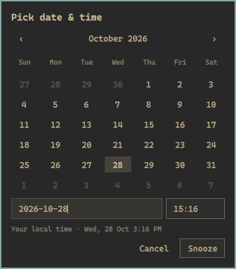

# Omarchy Notification Center

Quiet, grouped toasts and a searchable notification center for **Omarchy Quattro**.
Includes Gmail-style snooze scheduling, per-app delivery controls, native actions,
progress indicators, unread counts, timed Focus, and Undo.

Uses Omarchy's live theme, system/Nerd Font, surface borders, spacing, control
states and Hyprland corner radius. It does not change your global theme or font.



## Requirements

- The Quickshell-based **Omarchy Quattro** shell with the `omarchy.notifications`
  plugin and `qs.Ui`/`qs.Commons` components. Older Mako-based installations are
  not supported.
- Omarchy's existing Hyprland, Quickshell (Qt Quick Controls), Bash, coreutils,
  findutils and awk. No network service, cloud account, sudo or extra daemon.
- Node.js only for running tests; `notify-send` only for sending test messages.

Plugins run unsandboxed inside your desktop shell. Review the code before enabling.
Only one notification daemon can own the freedesktop notification service.

## Install

```sh
omarchy plugin add https://github.com/sarrietav-dev/omarchy-notifications --enable
omarchy restart shell
```

The manifest identifies this as a user-owned clone of `omarchy.notifications`.
Explicitly enabling it replaces the built-in service and adds its bell widget;
it does not edit files under `/usr/share/omarchy/`. Existing history is retained.
The plugin ID is **`sebas.notifications`**.

Optional shortcuts for `~/.config/hypr/bindings.lua` (check for conflicts first):

```lua
o.bind("SUPER + N", "Notification Center", "omarchy-shell notifications toggleCenter")
o.bind("SUPER + ALT + N", "Toggle notification Focus", "omarchy-shell notifications toggleDnd")
```

## Use

| Control | Action |
| --- | --- |
| Bell / `notifications toggleCenter` IPC | Toggle the right-side center |
| Right-click bell | Toggle Focus / Do Not Disturb |
| Hover a toast | Pause its timeout |
| Click a toast | Invoke its default action or focus its app |
| × / right- or middle-click / horizontal drag | Dismiss a toast |
| Click a center card / Expand | Show full content and available actions |
| Hover → snooze icon | Schedule a reminder with the calendar presets below |
| Snoozed · N | Inspect scheduled reminders and show one early |
| Settings | Grouping, image previews, reduced motion, limits and app delivery |

### Gmail-style snooze

Each option shows the actual local day and time alongside its label:

- **Later today:** 18:00.
- **Tomorrow:** 08:00 the next calendar day.
- **Later this week:** Friday at 08:00.
- **This weekend:** Sunday at 08:00, matching the reference menu.
- **Next week:** next Monday at 08:00.
- **Pick date & time:** a themed month calendar plus editable `YYYY-MM-DD` and
  24-hour `HH:MM` fields. Invalid/past dates and nonexistent DST times are rejected.

Presets already in the past are hidden. Dates use local calendar arithmetic,
including month/year rollover and daylight-saving changes, not fixed 24-hour offsets.
The custom picker opens inside the center so toast windows never steal keyboard focus.

Snoozing a grouped toast schedules all its members; a center card schedules just
that notification. Schedules survive shell restarts. Due reminders wait while Focus
is on or the app is Quiet/Blocked. **Show now** explicitly cancels that delay.

### Center and attention management

- Compact, macOS-inspired density: a left-aligned 32 px app icon, one title line,
  two body lines, tighter padding and a theme-colored hairline frame. Hover or
  keyboard selection reveals header controls without resizing the card; expand
  to reveal full content, media and native action buttons. Theme fonts and corner
  settings are unchanged. A representative message measures 83 px rather than
  164 px at the default 12 px font scale; exact heights depend on content/theme.
- Three visible toast groups by default, with overflow routed to the center.
- Bursts from the same app within 90 seconds share a toast; records remain separate.
- Critical alerts are distinct, sorted first and persistent, never merged together.
- History defaults to 100 entries (configurable up to 500), grouped by app/time.
- Search, expandable content, unread markers and five-second Undo for center dismissals.
- Focus durations: 15 minutes, 1 hour, tomorrow at 08:00, or indefinitely.
- Per-app **Allow** (toast + history), **Quiet** (history only), **Blocked** (discard).
- Images, native action buttons/overflow and sender `value` progress hints. Resident
  incomplete progress does not expire. Transient events stay out of history unless
  you explicitly turn one into a snoozed reminder.
- The icon slot prefers a supplied website/notification icon or avatar, falls back
  to the browser/application icon on missing or broken images, then to a glyph.
  The sender's local `image-path` is preferred over Quickshell's provider URL,
  because the provider paints a placeholder for a file that no longer exists and
  would otherwise defeat the fallback. Remote icon URLs are never fetched. No
  website favicon discovery happens: the page/browser chooses the supplied icon.

Keyboard: Down from search enters the list; arrows/J/K navigate, Space expands,
Enter opens, Delete dismisses, Shift+Delete dismisses a group, `/` searches and
Escape closes. Buttons, menus and the custom calendar are Tab/keyboard accessible.

## State and compatibility

Source is installed under `~/.config/omarchy/plugins/sebas.notifications/`.
Preferences are stored in `~/.config/omarchy/notifications.json`; notification
history, snooze deadlines, images and unread state stay under
`~/.local/state/omarchy/`. No notification content is sent over the network.

The original per-notification JSON history format is retained, with optional
snooze/progress fields. The image cache retains the upstream 5 MiB per-file limit;
archived images target a 64 MiB budget without evicting live reminder images.

The service is `keepLoaded`: source edits require `omarchy restart shell`.
UI preference changes apply immediately; manual preference-file edits need a restart.

Native callback actions require a live sender and cannot survive a shell restart.
Restored cards fall back to focusing the app; Omarchy's persisted argv actions can
still run. DND retains the upstream app-name bypass policy: app names are sender
claims, not authenticated identities or a security boundary. Any same-user session
bus client can send notifications; review upstream argv-action trust assumptions.

No inline replies, cross-device sync, quiet-hours digests or meeting/fullscreen
suppression are implemented. Physical multi-monitor arrangements, all possible
themes, touch dragging and screen readers have not been exhaustively tested.

## Remove / restore stock notifications

```sh
omarchy plugin disable sebas.notifications
omarchy plugin enable omarchy.notifications
omarchy restart shell
```

Then remove the disabled plugin through Omarchy's plugin settings if desired.
Remove only the optional keybindings you added. History remains readable by the
stock daemon, which applies its own smaller retention limit. Restore/wake pending
snoozes first: the stock daemon does not understand their deadlines.

## Development and diagnostics

```sh
node --test tests/*.test.js
omarchy plugin validate .
omarchy-shell notifications status
omarchy-shell notifications openCenter
omarchy-shell notifications closeCenter
omarchy-shell notifications focusFor 15
omarchy-shell notifications snoozeLast 5
omarchy-shell notifications pickSnooze
omarchy-shell notifications wakeSnoozed
```

`Attention.js` and `NotificationLogic.js` contain pure tested policy/parsing code.
`Service.qml` owns delivery and the serialized persistence queue; `CenterState.qml`
owns state/policy, while `components/` owns presentation. Live notification QObjects
are deliberately kept out of ListModels to avoid stale-pointer crashes.

Upstream changes do not merge into this clone automatically. Compare the installed
Omarchy notification service before incorporating upstream updates.

## License

MIT. Derived from Omarchy's notification implementation, copyright David Heinemeier
Hansson; notification-center and snooze additions copyright sarrietav-dev.
See [LICENSE](LICENSE) and [NOTICE.md](NOTICE.md).
